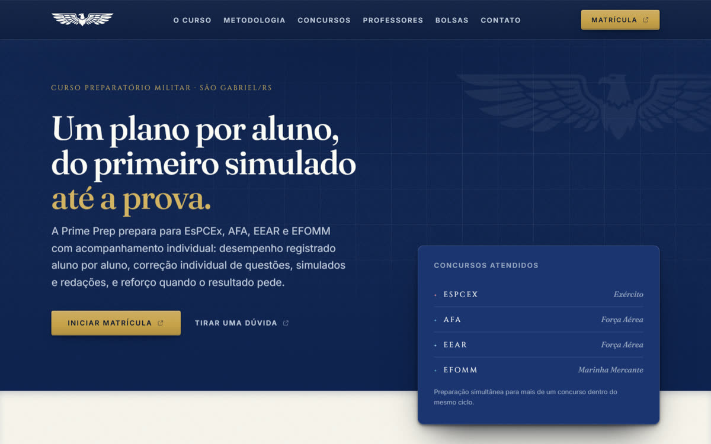

# Prime Prep

**Português** · [English](#english)

Site institucional da **Prime Prep**, curso preparatório para concursos militares em São Gabriel/RS, que fundei e que está em pausa. Projetei e desenvolvi o site com Next.js, React e TypeScript.

Estático, sem backend e sem formulário. A conversão acontece por WhatsApp e pela DM do Instagram, com a intenção do visitante já declarada na primeira mensagem.

<p align="center">


</p>

> **Sobre esta versão pública.** Este repositório é um snapshot do repositório privado de desenvolvimento, publicado em 10/11/2026 sem o histórico de commits. Duas mudanças em relação ao original: o nome e a formação dos outros dois professores foram substituídos pela disciplina que lecionam, e o arquivo de referência do logotipo foi retirado. O site nunca foi publicado em um domínio; as capturas acima são do build de produção rodando localmente.

| Verificação (snapshot, 10/11/2026) | Resultado |
| --- | --- |
| `npm run check` (TypeScript, ESLint, Prettier, Vitest) | 173 testes aprovados, sem erros |
| `npm run build` | 13 páginas estáticas (34 rotas pré-renderizadas, contando imagens Open Graph e ícones) |
| Celular a 390 px | sem rolagem horizontal |

---

## Rodar

```bash
npm install
npm run dev
```

Abre em `http://localhost:3000`. Copie `.env.example` para `.env.local` se precisar apontar para um domínio ou liberar indexação.

## Comandos

| Comando | O que faz |
|---|---|
| `npm run dev` | Servidor de desenvolvimento |
| `npm run check` | **Antes de entregar.** Typecheck, lint, formatação e testes |
| `npm test` | Só os testes |
| `npm run build` | Build de produção |
| `npm run assets:marca` | Regera ícones e as marcas claras do Open Graph |

---

## Por onde começar a ler

1. **[`PROJECT_CONTEXT.md`](PROJECT_CONTEXT.md)** — o mapa. Stack, arquitetura, conversão, estado.
2. **[`DESIGN.md`](DESIGN.md)** — o sistema visual: tokens, superfícies, profundidade, movimento, e as regras nomeadas.
3. **[`AGENTS.md`](AGENTS.md)** — as regras invioláveis. Leia antes de tocar em qualquer coisa.
4. **[`PRODUCT.md`](PRODUCT.md)** — quem é o público e o que o negócio faz.

Documentação por fase em [`docs/`](docs/): planejamento, setup e implementação. As **67 decisões numeradas** ficam em [`docs/setup/setup-decisions.md`](docs/setup/setup-decisions.md), cada uma com motivo, verificação e impacto. É o arquivo que responde "por que isto está assim".

---

## As regras que não se quebram

Estão inteiras em [`AGENTS.md`](AGENTS.md). As três que mais importam:

**Nada inventado.** Preço, endereço, telefone, aprovações, depoimentos e CNPJ só entram com fonte fornecida pelo cliente. Campo não confirmado é `null` e a interface trata ausência como ausência. Dado de edital usa `DadoReferencia<T>`, que com `verifiedAt: null` **obriga** a interface a marcar como referência, nunca como definitivo.

**A marca só entra por [`Wordmark.tsx`](src/components/layout/Wordmark.tsx).** Nunca redesenhar, vetorizar ou reconstruir. E o livro nunca é usado sozinho.

**Só tokens semânticos.** Nenhum valor fixo de cor, espaço, raio ou duração.

Boa parte disso é verificada automaticamente: `npm run check` falha se alguém inventar um dado, marcar um edital como confirmado sem data, usar travessão na copy pública ou aplicar o livro isolado.

---

## Testes

173 testes, em oito arquivos. O que eles cobrem:

- **`diagnostico.test.ts`** — as 180 combinações de resposta do diagnóstico, exaustivas, com invariantes. Nenhum concurso some ou duplica, nada fora da faixa etária é recomendado, todo recomendado tem motivo.
- **`conversion.test.ts`** — destinos e mensagens. Um `href: null` nunca pode virar link morto.
- **`invariantes.test.ts`** — as regras do `AGENTS.md` transformadas em verificação.
- **`paginas-de-erro.test.tsx`** — o contrato das telas de erro.
- **`seo-e-assets.test.ts`** — dados estruturados sem campo inventado, ícones presentes, cabeçalhos de segurança.
- **`movimento.test.ts`** — nenhuma animação decide se o conteúdo é visível, movimento reduzido é respeitado, e a folha de impressão desfaz o esconder do reveal (sem ela a página imprimia quase em branco).
- **`mascaras-da-marca.test.ts`** — o fallback do AVIF, que falha de um jeito visível se sumir, e as marcas que o alto contraste forçado apagaria.
- **`cores-literais.test.ts`** — os poucos hex escritos fora do CSS não podem divergir dos tokens, e o modo de mais contraste leva o site a AAA sem apagar o degrau tonal errado.

**Não há `jsdom`, e é decisão.** Comportamento de interface é verificado medindo o DOM renderizado no navegador de verdade. Foi assim que apareceram os defeitos que importaram: um token de container sombreando a utilidade `w-full` do Tailwind, um trilho `sticky` que nunca grudou porque era item de grade esticado, e uma paralaxe amarrada a um container que não rola. Nenhum apareceria num DOM simulado.

---

## Antes de publicar

Pendências completas em [`docs/implementation/content-pending.md`](docs/implementation/content-pending.md). O que bloqueia:

- [ ] **Marca em SVG** com variações. O raster está em uso correto e proporcional, mas SVG escala melhor. Troca em um arquivo só.
- [ ] **Símbolo isolado** para o favicon. O ícone de aba usa a wordmark (PRIME + livro), que é o recorte existente que melhor se lê a 32px: medido contra os outros dois, a marca completa sai ilegível e a águia sozinha, a 4.86:1, ocupa 20% do quadrado. A 16px nenhum recorte de 2:1 se lê, e isso só se resolve com um símbolo quadrado.
- [ ] **Domínio** em `NEXT_PUBLIC_SITE_URL`, senão canonical, Open Graph e sitemap apontam para `localhost`.
- [ ] **Liberar indexação** com `NEXT_PUBLIC_ALLOW_INDEXING=true`.
- [ ] **Conferir a remuneração da EFOMM.** O material do cliente diverge entre ~R$ 13 mil e R$ 15 a 24 mil. O site usa o segundo.

Já resolvido: `/dev/foundation` some sozinho em produção, e o favicon genérico do scaffold saiu.

**Nenhum deploy foi feito**, e nenhuma integração de deploy está conectada.

---

## English

Marketing site for **Prime Prep**, a military-exam prep course in São Gabriel, Brazil, which I founded and which is currently on hold. I designed and built it with Next.js, React and TypeScript.

It is fully static: no backend and no form. Visitors reach the course through WhatsApp or Instagram DMs, with their intent (enrollment, scholarship, question) already written into the first message.

Highlights:

- **No invented data.** Prices, address, approvals and testimonials only appear when sourced. Exam data uses a `DadoReferencia<T>` type that forces the UI to label it as reference, and tests fail if anyone fabricates a field.
- **Exam finder** (`/diagnostico`): four questions that point to EsPCEx, AFA, EEAR or EFOMM, computed in the browser. All 180 answer combinations are tested.
- **Accessibility:** `prefers-reduced-motion`, `prefers-contrast: more` (AAA on every route), forced colors, `prefers-reduced-transparency` and a print stylesheet.
- **Motion in CSS only**, with no animation library; content visibility never depends on an animation.
- **Security headers**, structured data, per-page Open Graph images and a design-system page hidden in production.

**About this public version.** This repository is a snapshot of the private development repository, published on 10 Nov 2026 without its commit history. The other two teachers' names and credentials were replaced with the subjects they teach, and the logo reference file was removed. The site has never been deployed; the screenshots come from the production build running locally. The rest of the documentation is in Portuguese.

```bash
npm ci
npm run check   # typecheck, lint, formatting and 173 tests
npm run dev     # http://localhost:3000
```
